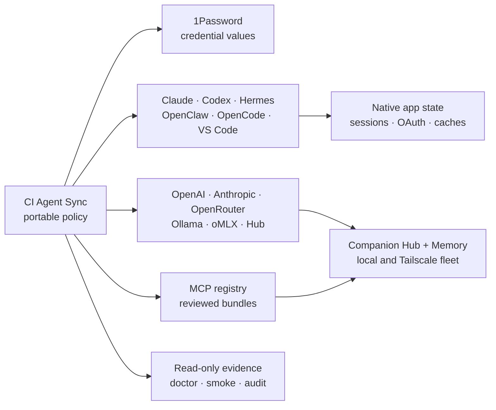
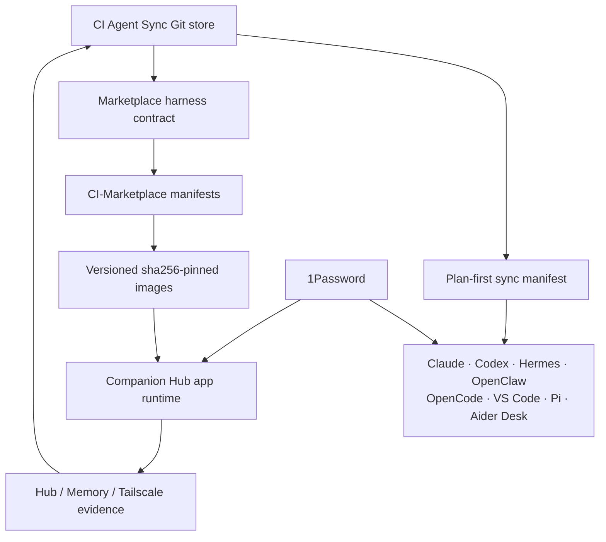

# CI Agent Sync

> A portable map for every agent, model, and mission.

CI Agent Sync is the user-facing name for this repository. It is the local,
versionable home for Companion Intelligence harness recipes, provider routes,
MCP bundles, workflow packs, redacted audits, and safe operator helpers.

The store is maintained in
[companionintelligence/CI-Agent-Sync](https://github.com/companionintelligence/CI-Agent-Sync). It is a
portable control plane, not a mirror of native app state: credential values
stay in the shared 1Password vault, while reviewed recipes and redacted audits
live here. Client-native OAuth state, sessions, model caches, and device
identity remain local to each app.


## TL;DR

| Goal | Run | Result |
| --- | --- | --- |
| Prepare a new machine | `./scripts/bootstrap-machine.zsh` | Installs the safe local shell of the store |
| Connect credentials | `./bin/agentctl credentials op setup` then `./bin/agentctl credentials op import` | Uses 1Password without copying values into Git |
| Open the GUI | `./bin/agent-atlas --open` or `./bin/agentctl atlas --open` | Starts the loopback-only CI Agent Sync setup wizard |
| Check the machine | `./bin/agentctl doctor --json` | Reports commands, configs, endpoints, and credential backend status |
| Check Hub + Memory CLIs | `./bin/agentctl companion status --json` | Runs the native `cihub` and `ci` checks through one stable bridge |
| Use a terminal menu | `./bin/agentctl companion tui` | Launches a small read-oriented TUI for Hub, Memory, readiness, and backup |
| Check the fleet | `./bin/agentctl fleet smoke --json --strict` | Verifies Tailscale and Hub liveness for named targets |
| Audit Marketplace apps | `./bin/agentctl marketplace audit --strict` | Checks release tags, Hub/Memory wiring, and image pins |
| Generate portable config | `./bin/agentctl render --agent all` | Writes ignored cross-harness artifacts under `local/rendered/` |
| Back up agent configs | `./bin/agentctl backup` | Creates a redacted snapshot under `local/backups/` |
| Plan a sync | `./bin/agentctl sync` | Shows what would be distributed; use `--apply` only after review |

The shortest useful setup is:

```sh
git clone https://github.com/companionintelligence/CI-Agent-Sync.git
cd CI-Agent-Sync
cp profiles/machines/macos-laptop.yaml.example profiles/machines/local.yaml
./scripts/bootstrap-machine.zsh
npm install
./bin/agentctl credentials op setup
./bin/agentctl credentials op import
./bin/agent-atlas --open
```

## Open the setup wizard

CI Agent Sync is a TypeScript web wizard backed by the real YAML store. Node 22
and the small `yaml` package provide the portable runtime; no framework or
daemon is required. It binds to `127.0.0.1:8787` and walks through the smallest
useful setup path: connect 1Password, choose harnesses, pick a profile,
generate portable config artifacts, and create a redacted backup of the agent
configs on this machine.

The CI Agent Sync control plane is Node/npm-only. You do not need Bun to
install, build, test, or run this repository. The workspace inventory may
describe package managers used by independent Companion Intelligence repos;
those entries do not change this repository's Node-only runtime.

```sh
./bin/agent-atlas --open
# equivalent entry point:
./bin/agentctl atlas --open
```

Useful alternatives:

```sh
./bin/agent-atlas                 # start without opening a browser
./bin/agent-atlas --port 9090    # choose another local port
./bin/agent-atlas --check         # validate the bundled web assets
```

The wizard can invoke only two explicit local actions: the TypeScript render
operation to generate ignored portable artifacts under `local/rendered/`, and
the TypeScript backup operation to create a redacted snapshot under
`local/backups/`. It does not
write native harness state, create credentials, claim Hub, change fleet nodes,
or deploy applications. Read-only Doctor, fleet, and Marketplace evidence
remains available through the CLI and the wizard's local API.

Full route and safety details are in [docs/agent-atlas.md](docs/agent-atlas.md).

To expose the console beyond the laptop, you must opt in explicitly with
`--allow-remote`; the console adds no authentication, so loopback is the
recommended and supported default.

## How the pieces fit



The operating rule is simple: policy travels, identity stays local, and every
write crosses an explicit approval boundary.

## Why TypeScript instead of Ruby?

The first version used Ruby's standard library because it was a quick,
zero-dependency way to serve a loopback wizard. That was useful for the first
audit, but it made the control plane unlike the TypeScript/Node-based
Companion Intelligence products and harder to share with frontend and MCP
tooling. The current runtime separates the layers cleanly:

| Layer | Implementation | Reason |
| --- | --- | --- |
| Control plane | TypeScript on Node 22 | Shared types, async HTTP/MCP-friendly integrations, and the same language as CI-Hub, CI-Common, and the marketplace |
| Browser | TypeScript source bundled to browser JavaScript | Typed mobile-first wizard without a frontend framework or server build requirement at runtime |
| Brand | Pinned CI-Common 1.6.0 bundle | Offline, hash-verified tokens, logo assets, and fonts; no sibling checkout dependency |
| Compatibility | `bin/agent-store-legacy` and `scripts/*.rb` | Existing credential and specialized operator paths remain available while their individual implementations are ported |

The public entry points are now TypeScript-backed: `bin/agentctl`,
`bin/agent-store`, and `bin/agent-atlas`. Run `npm run build` when changing
TypeScript or the browser source, then use `./bin/agentctl check` before
publishing a change.

## What is portable

| Layer | Stored in CI Agent Sync | Deliberately left outside Git |
| --- | --- | --- |
| Policy | Provider names, fallback chains, MCP recipes, capability bundles, workflows | Secret values and one-off machine overrides |
| Credentials | 1Password item references and environment mappings | API keys, OAuth refresh tokens, cookies, private keys |
| Harnesses | Redacted config shapes, skills/plugins, setup and audit recipes | Sessions, transcripts, native databases, device identity |
| Runtime | Read-only probes and evidence schemas | Model weights, app caches, running containers |
| Distribution | Versioned sync manifest and rollback policy | Unreviewed arbitrary file copying |

## Secret policy

Secrets are never copied into this repository. Provider credentials use the
shared 1Password `Agent Configs` vault through `op://` references; Keychain and
Secret Service are migration fallbacks only.
Tool-specific OAuth files remain in their native application directories.
Audits and config snapshots redact credential-bearing fields.

## Harness coverage

| Harness or runtime | Role in the stack | Portable layer | Native state stays in |
| --- | --- | --- | --- |
| ChatGPT | Hosted planning and review | Context, workflows, handoff recipes | ChatGPT account and desktop app |
| Claude | Cloud/local coding and MCP | Provider routes, MCP bundles, skills | Claude app and OAuth store |
| Codex | Coding, review, and deployment | Provider routes, MCP bundles, approval policy | Codex app and CLI state |
| Hermes | Local-first coding and tools | Hermes config shape, provider fallback, MCP recipes | `~/.hermes` |
| OpenClaw | Gateway-based coding and automation | Gateway recipe, local model handoff, Hub wiring | `~/.openclaw` and gateway identity |
| OpenCode | Multi-provider coding | Provider catalog, plugins, MCP recipes | OpenCode config and sessions |
| Aider Desk | Desktop coding companion | MCP recipe and provider mapping | Native desktop app data |
| Pi | Lightweight coding surface | Provider mapping and MCP recipe | `~/.pi` |
| Antigravity | Desktop coding and engineering | MCP bundles and safe operating context | Native desktop app data |
| VS Code | Editor, browser, and development MCP | Extensions, settings, MCP template | VS Code User data |
| Ollama / oMLX | Local inference backends | Endpoint names and fallback policy | Model weights and runtime processes |

## Capability bundle guide

| Bundle | Best for | Adds | Risk posture |
| --- | --- | --- | --- |
| `core` | Everyday work | Hub, Memory, Engineering read surfaces | Read-oriented default |
| `development` | Coding and docs | CI-Common, MarkItDown, Playwright, GitHub | Review before external writes |
| `marketing` | Product videos and social | Brand Studio, CI-Common, Metricool | Publishing remains approval-gated |
| `operator-readonly` | CEO and launch readiness | Hub control-room observability | Read-only evidence |
| `platform-qa` | Marketplace and fleet validation | CI-Engineering fleet QA | Explicit target and confirmation |
| `mobile` | Android workflows | Android remote control MCP | High-risk, opt-in |
| `operator-admin` | Hub administration | Approved Hub write path | High-risk, preflight required |
| `deployment-admin` | Cloudflare and Hub deploys | Deployment credentials and recipes | High-risk, post-deploy probe |

## Sync and release path



### Marketplace bridge

| Source of truth | What it owns | How Atlas checks it |
| --- | --- | --- |
| `agent-configs` | Portable policy and public harness expectations | `agentctl validate`, `agentctl marketplace audit` |
| CI-Hermes / CI-OpenClaw | Source releases and native runtime behavior | Optional local source-tag comparison |
| CI-Marketplace | Installable manifests and image references | Catalog contract tests and image-pin checks |
| Companion Hub | Active credentials, models, routes, and runtime state | Read-only Hub/fleet probes |

The contract is deliberately public and credential-free:
[integrations/marketplace-harnesses.yaml](integrations/marketplace-harnesses.yaml).
Use the audit when a source release or catalog manifest changes:

```sh
./bin/agentctl marketplace audit \
  --marketplace /path/to/CI-Marketplace \
  --sources-root /path/to/source-checkouts \
  --strict
```

Start here:

```sh
./bin/agentctl inventory
./bin/agentctl doctor --json
./bin/agentctl test
./bin/agentctl conformance --json
./bin/agentctl readiness --json --from-1password
./bin/agentctl report --json --from-1password --deploy
./bin/agentctl profile list --json
./bin/agentctl profile show ceo --json
./bin/agentctl ledger plan --action fleet_qa_start --target 'fleet-qa:apps/full:nodes=core-a' --reason "release validation"
# approve the returned id only after reviewing the target and preflight
./bin/agentctl ledger approve --id LEDGER_ID --confirm
./bin/agentctl hub smoke --json
./bin/agentctl hub smoke --json --strict --from-1password
./bin/agentctl memory smoke --json
./bin/agentctl fleet smoke --json
./bin/agentctl deploy doctor --json
./bin/agentctl backup
./bin/agentctl repair openclaw
./bin/agentctl credentials op status
./bin/agentctl render
./bin/agentctl sync
./bin/agentctl install
```

The underlying commands remain available for compatibility:

```sh
./bin/agent-store inventory
./bin/agent-store credentials status
./bin/agent-store audit hermes
./bin/agent-store audit openclaw
./bin/agent-store audit all
./bin/agent-store snapshot
./bin/agent-store vscode audit
./bin/agent-store repos inventory
./bin/agent-store repos sync
./bin/agent-store render
./bin/agent-store sync
./bin/agent-store fallbacks
./bin/agent-store doctor
./bin/agent-store doctor --json
./scripts/bootstrap-machine.zsh
```

The control-plane lifecycle, separation of policy/secrets/native state, and
portable recovery model are documented in
[docs/control-plane.md](docs/control-plane.md). Harness readiness is tested in
tiers described by [docs/harness-parity.md](docs/harness-parity.md). The
cross-surface readiness schema, portable evidence bundle, and approval ledger
are defined in [integrations/operator-contract.yaml](integrations/operator-contract.yaml).
Workflow packs for CEO, engineering, and marketing work are in
[integrations/workflow-packs.yaml](integrations/workflow-packs.yaml).

## Companion Hub and Memory CLI bridge

CI Agent Sync works alongside the native Companion Hub `cihub` CLI and
Companion Memory `ci` CLI. It does not replace either command line or copy
their implementation. Use the bridge when you want the portable control plane
to discover and launch the native tools from one command:

```sh
./bin/agentctl companion status
./bin/agentctl companion status --json
./bin/agentctl companion status --from-1password --json
./bin/agentctl companion hub status local
./bin/agentctl companion hub pool status local
./bin/agentctl companion memory doctor --graphql
./bin/agentctl companion memory stats --json
./bin/agentctl companion tui
```

The combined status check runs Hub `status` and Memory `doctor --graphql` with
bounded timeouts. It discovers installed binaries first and then falls back to
the local Companion-Hub / CI-Memory checkouts. Set `CIHUB_BIN`, `CI_MEMORY_CLI`,
`CI_HUB_ROOT`, or `CI_MEMORY_ROOT` when a machine uses a non-standard layout.
`COMPANION_MEMORY_BASE_URL` is passed to the native Memory CLI as `--server`;
credential values remain in the environment or 1Password. See
[docs/companion-cli.md](docs/companion-cli.md) for the JSON contract, TUI
menu, and discovery rules.

Provider order and safety rules are in
[integrations/providers/fallbacks.yaml](integrations/providers/fallbacks.yaml).
The compact context that travels with each target is in
[context/agent-operating-context.md](context/agent-operating-context.md).
Fallbacks are local-first and health-gated; remote providers require explicit
enablement, and no fallback is allowed after a mutation begins.

Reviewed MCPs are grouped in
[integrations/capability-bundles.yaml](integrations/capability-bundles.yaml):
`core`, `development`, `marketing`, `operator-readonly`, and high-risk
`mobile`/`operator-admin`/`deployment-admin`. Bundles describe
what can be enabled; they do not copy credentials or silently enable remote or
device-control tools.

The Companion Hub control-room and CEO change contract are in
[integrations/hub-operator.yaml](integrations/hub-operator.yaml) and
[workflows/ceo-operations.md](workflows/ceo-operations.md). The control-room
probe is read-only and keeps the Hub's MCP, `qa:read`, and `inference` keys
separate so a model can diagnose the appliance without receiving an admin key.

The laptop integration surfaces are also explicit: `memory smoke` checks the
local Companion Memory Caddy origin, `fleet smoke` checks Tailscale-named Hub
liveness across the verified beta/core targets, and `deploy doctor` checks
Cloudflare identity plus local Hub/Memory/Tailscale state without deploying.
See [workflows/deployment.md](workflows/deployment.md) for the confirmation
gates for Wrangler, Hub catalog submission, and fleet updates.

Set up the portable 1Password backend first:

```sh
./bin/agentctl credentials op setup
./bin/agentctl credentials op import
./bin/agentctl credentials op status
```

The import keeps native migration copies until verification. See
[docs/onepassword.md](docs/onepassword.md) for the desktop integration,
headless service-account, rotation, and fallback policy.

For a provider credential that is not yet migrated, add it locally without
putting it in chat or a tracked file:

```sh
./bin/agent-store credentials set anthropic
./bin/agent-store credentials set openai
./bin/agent-store credentials set openrouter
./bin/agent-store credentials set ollama
./bin/agent-store credentials set omlx
./bin/agent-store credentials set companion-hub
./bin/agent-store credentials set companion-hub-qa
./bin/agent-store credentials set companion-hub-inference
./bin/agent-store credentials set companion-hub-fleet-qa
./bin/agent-store credentials set companion-memory
./bin/agent-store credentials set omniroute
./bin/agent-store credentials set android-mcp
./bin/agent-store credentials set cloudflare
```

Run a client with a provider credential injected only into that process:

```sh
./bin/agent-store with anthropic -- claude
./bin/agent-store with openai -- codex
```

See [docs/audit-checklist.md](docs/audit-checklist.md) for the full review
scope and [reports/2026-10-24-hermes-openclaw.md](reports/2026-10-24-hermes-openclaw.md)
for the first completed phase. The portable setup and Companion Intelligence
repository map are in [docs/portable-setup.md](docs/portable-setup.md) and
[repos/companionintelligence.yaml](repos/companionintelligence.yaml).

The repository distribution contract is in [sync/](sync/README.md). It uses a
versioned manifest, target-local group selection, explicit deletion records,
and plan-first application so reviewed policies can be transplanted without
copying native auth or credentials.

The first-party Marketplace projections of Hermes and OpenClaw are covered by
the read-only release contract in
[integrations/marketplace-harnesses.yaml](integrations/marketplace-harnesses.yaml).
Audit a local catalog checkout and, when available, its source checkouts with:

```sh
./bin/agentctl marketplace audit \
  --marketplace /path/to/CI-Marketplace \
  --sources-root /path/to/source-checkouts
```

The audit checks the catalog version against every image tag, requires
sha256-pinned images, verifies Hub MCP and Companion Memory wiring, checks the
standardized inference handoff names, and optionally compares the catalog
version with the latest local release tag in CI-Hermes and CI-OpenClaw. It
never reads or prints a credential. This is the bridge between the portable
cross-harness policy and the Hub-managed Marketplace app environment; the Hub
still remains the runtime source of truth for keys and active model routing.

For the marketing stack, start with
[workflows/marketing-video.md](workflows/marketing-video.md). It connects
CI-Brand-Studio planning, CI-Common production, CI-Engineering evidence, and
Metricool analytics across Claude, Codex, OpenCode, and VS Code, with opt-in
recipes for lean local Hermes and OpenClaw.

ChatGPT is tracked as a first-class desktop harness, but its hosted account
and native app database remain local. The portable provider chain is injected
into Codex CLI, Hermes, OpenClaw, Claude, OpenCode, Aider Desk, Pi, Antigravity,
and VS Code; ChatGPT can review or prepare work and then hand an approved
command to a local harness.

The latest fallback and cross-harness evidence is recorded in
[reports/2026-10-24-fallbacks-history-test.md](reports/2026-10-24-fallbacks-history-test.md).
The portable control-plane, OpenClaw repair, and live local-model evidence are
recorded in
[reports/2026-10-24-control-plane-hardening.md](reports/2026-10-24-control-plane-hardening.md).
The current laptop, local Memory/Hub, Tailscale fleet, Cloudflare, and harness
readiness review is recorded in
[reports/2026-10-24-laptop-ceo-operator-review.md](reports/2026-10-24-laptop-ceo-operator-review.md).
The internal MCP source review is in
[reports/2026-10-24-internal-mcp-registry.md](reports/2026-10-24-internal-mcp-registry.md).

For CI-Hub fleet work, use the plan-first policy in
[integrations/fleet/pool-policy.yaml](integrations/fleet/pool-policy.yaml) and
follow [docs/fleet-operations.md](docs/fleet-operations.md). The latest
repair evidence is in
[reports/2026-10-24-fleet-pool-repair.md](reports/2026-10-24-fleet-pool-repair.md).

For whole-platform and marketplace QA, select the `platform-qa` bundle and
follow [workflows/platform-qa.md](workflows/platform-qa.md). It exposes the
guarded CI-Engineering `fleet_qa_*` MCP tools to every supported local
harness, requires an explicit node list or `all: true`, and requires
confirmation before marketplace app-suite control. The per-node
`FLEET_HUB_API_KEYS_JSON` value is stored only as
`agent-configs-companion-hub-fleet-qa` in 1Password.

The mobile references are catalogued in
[integrations/references.yaml](integrations/references.yaml). The Android
remote-control MCP is deliberately opt-in and high-risk; the private Companion
Scan document is stored as a link only, without importing its credentials or
device-specific endpoints.
